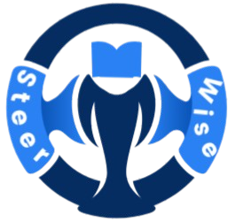
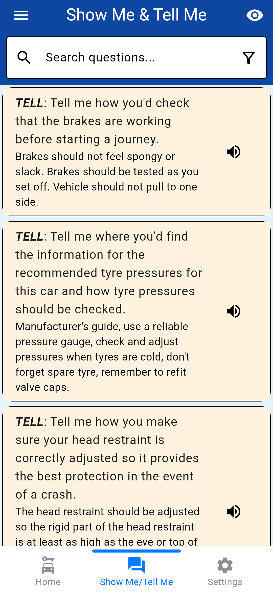
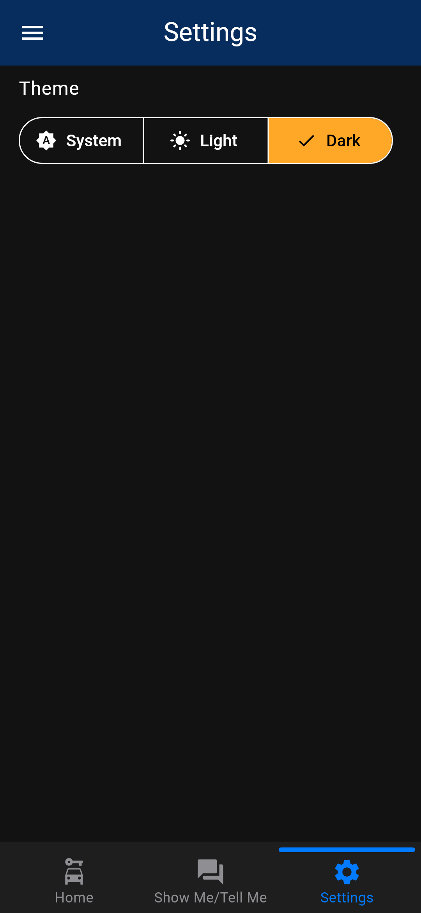
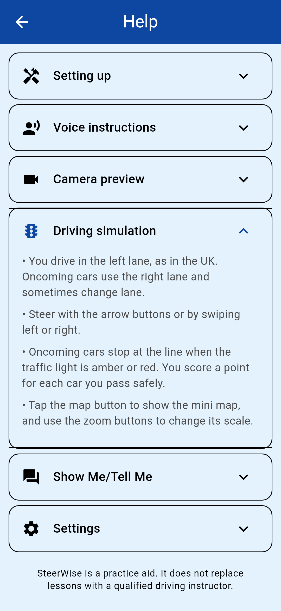
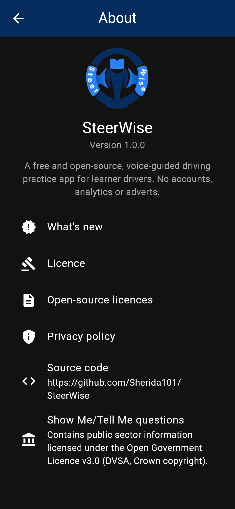
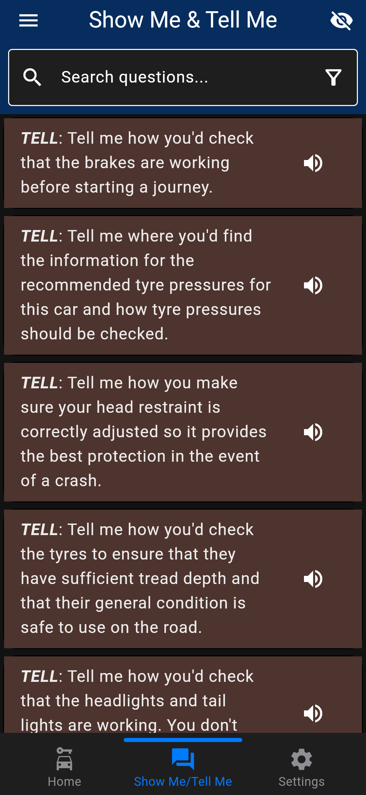
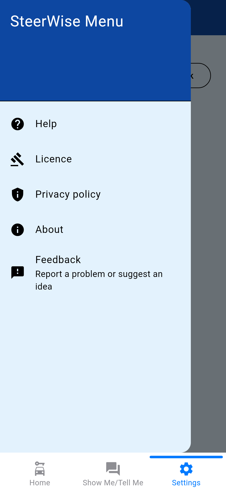
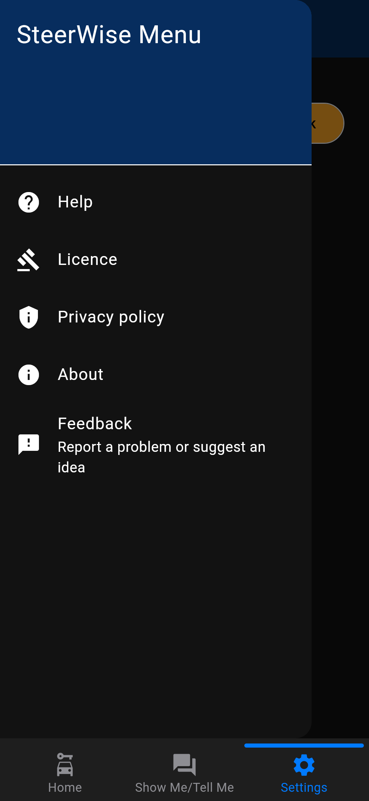
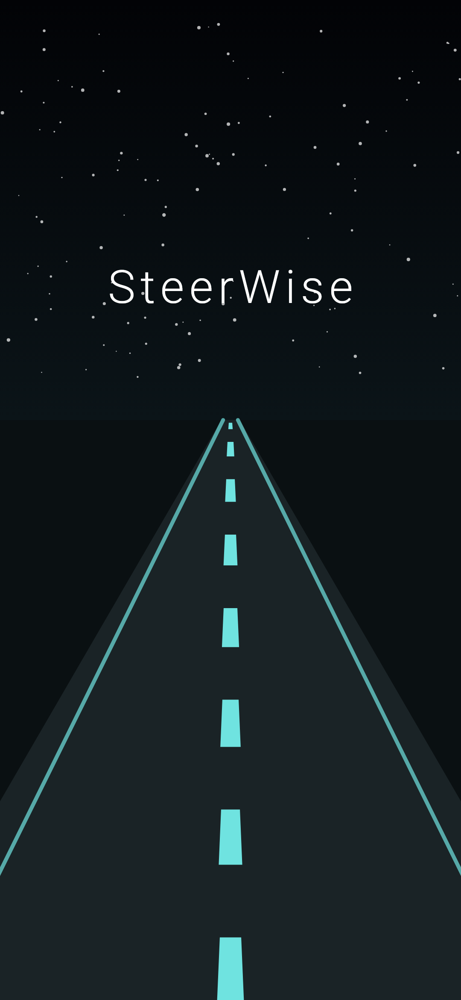

<a id="top"></a>

# SteerWise



[](LICENSE)


## Table of Contents

- [Overview](#overview)
- [Use Case](#use-case)
- [Features](#features)
- [Screenshots](#screenshots)
- [Requirements](#requirements)
- [Development Setup](#development-setup)
- [Running the application](#running-the-application)
- [Testing the application](#how-to-test)
- [Formatting project code](#how-to-format-code)
- [Releasing the application](#how-to-release)
- [F-Droid metadata](#f-droid-metadata)
- [Licence](#licence)
- [Contributing](#contributing)
- [Developer notes](#developer-notes)
- [Other projects](#other-projects)
- [Support](#support)

---

## Overview

SteerWise is a smart, voice-guided driving trainer app designed to help learner drivers improve their road awareness and technique. It provides spoken instructions, a simulated UK road, a live camera preview and the Show Me/Tell Me questions from the UK practical driving test - all within a practice-friendly app.

Whether you're preparing for your driving test or improving your push-pull steering technique with a dinner plate at home, SteerWise is your intelligent driving companion.

---

## Use Case

1. Mount your phone or tablet in front of your steering wheel prop (e.g., a dinner plate).
2. A simulated road with oncoming traffic, traffic lights and pedestrians appears on screen.
3. Voice instructions guide you through actions like turning at a junction or exiting a roundabout.
4. You practise the correct steering technique using the visual and spoken cues, watching your hands in the camera preview.

---

## Features

| Feature | Description | Screenshot |
| ------- | ----------- | ---------- |
| **Voice-guided instructions** | Spoken prompts such as "Turn left at the junction" or "Take the second exit at the roundabout". Step through them with **Next Instruction**, or start **Auto Mode** for a new instruction every 8 seconds. **Get Feedback** shows a steering tip. |  |
| **Driving simulation** | A UK left-hand-traffic road with oncoming cars that stop at red and amber traffic lights, pedestrians, a score and collision detection with Retry. Steer between lanes with the arrow buttons or by swiping. A zoomable mini map shows your route. Pauses while another tab is showing. |  |
| **Camera preview** | A live preview from the front camera so you can watch your hands on the wheel, with a button to switch to the rear camera. Runs at a low resolution with audio off, turns off when you switch tab or leave the app, and nothing is recorded. |  |
| **Show Me/Tell Me questions** | The vehicle safety questions from the UK practical driving test. Search them, filter by Show or Tell, switch between Test Mode and Practice Mode (answers shown), and have questions read aloud in a British English voice. |  |
| **Themes** | Light, dark and system themes. Your choice is saved on the device and used from the first frame. |  |
| **Help** | Built-in guidance for setting up, the voice instructions, the camera, the driving simulation and the Show Me/Tell Me questions. |  |
| **About, licences and privacy** | App version, what's new, the licence, open-source licences, the privacy policy and a source code link, all available offline. **Feedback** in the side menu opens the GitHub issue form. |  |
| **Privacy** | No accounts, analytics or adverts. Settings stay on the device and nothing is sent to the developers. See the [privacy policy](PRIVACY_POLICY.md). | |

### Possible future features include:

See [planned-features.md](docs/md/planned-features.md).

---

## Screenshots

| Light theme | Dark theme |
| ----------- | ---------- |
|  |  |
|  |  |
|  |  |

---

## Requirements

- **[Flutter](https://flutter.dev/)** (stable channel; CI uses 3.47.7) with the **Dart SDK** `^3.8.1`
- **Android Studio / Android SDK** - for compiling and testing on Android
- **VS Code** (optional) - code editor

Main packages:

- **[camera](https://pub.dev/packages/camera)** - Live camera preview
- **[flutter_tts](https://pub.dev/packages/flutter_tts)** - Text-to-speech instructions (uses the device's speech engine; free engines such as RHVoice and eSpeak NG are on F-Droid)
- **[provider](https://pub.dev/packages/provider)** + **[shared_preferences](https://pub.dev/packages/shared_preferences)** - App state and saved settings

---

## Development setup

```bash
# Check environment health
flutter doctor

# Fetch all dependencies
flutter pub get

# Run the app on a connected device or emulator
flutter run
```

If the build behaves oddly after changing dependencies, run `flutter clean` and then `flutter pub get` again.

---

## Running the application

Please follow the steps in the [project setup section](docs/md/project-setup.md) to set up and run the app locally.

See the [architecture section](docs/md/architecture.md) for a detailed overview of the project structure and the [developer notes](docs/md/developer-notes.md) for useful commands and release steps.

Common tasks are also available through the [Makefile](Makefile) - run `make help` to list them.

---

## How to test

```bash
# Unit and widget tests (no device needed)
flutter test

# On-device integration tests, on any connected device or emulator.
# On Android, allow camera access when asked.
flutter test integration_test

# The same tests as Android instrumentation tests (camera access is granted
# automatically)
make android-test
```

---

## How to format code

```bash
# Format and analyse
dart format .
flutter analyze

# Preview, then apply, automatic fixes
dart fix --dry-run
dart fix --apply

# Sort package imports
dart run import_sorter:main

# Check licensing (REUSE) and non-free dependencies
make reuse-lint
make foss-audit
```

---

## How to release

This project uses GitHub Actions for automated releases. Pushing a tag matching `v*` to the `main` branch builds a release APK and app bundle and publishes them as a GitHub release. They are signed with the release key once the keystore secrets are set up (see the [developer notes](docs/md/developer-notes.md#releasing-the-application-notes)).

```bash
git tag v1.0.0
git push origin v1.0.0
```

---

## F-Droid metadata

This project includes Fastlane compatible metadata under `fastlane/metadata/android/en-GB/` (store text, icon and screenshots) to ensure F-Droid repository listing compliance.
The F-Droid build recipe lives in [`metadata/com.asptechinc.steerwise.yml`](metadata/com.asptechinc.steerwise.yml).

F-Droid signs APKs itself, so the recipe builds an unsigned release APK:

```bash
UNSIGNED_RELEASE=true flutter build apk --release
```

The [FOSS audit workflow](.github/workflows/foss_audit.yml) checks that no non-free libraries are added and runs `reuse lint` and `fdroid lint` on every push and pull request to `main`.

---

## Licence

The project is open-sourced under the [MIT License](LICENSE). You can use, modify and distribute this project as long as you include the original licence. Licensing for every file is recorded in [REUSE.toml](REUSE.toml) and checked with [`reuse lint`](https://reuse.software).

The Show Me/Tell Me questions contain public sector information licensed under the [Open Government Licence v3.0](https://www.nationalarchives.gov.uk/doc/open-government-licence/version/3/), from the DVSA's [car show me tell me vehicle safety questions](https://www.gov.uk/government/publications/car-show-me-tell-me-vehicle-safety-questions).

---

## Contributing

Contributions are welcome! Please read [CONTRIBUTING.md](CONTRIBUTING.md) for guidelines on code style, testing and pull requests and follow the [Code of Conduct](CODE_OF_CONDUCT.md).

If you find any issues or have suggestions, feel free to [open an issue](https://github.com/ASPTechInc/SteerWise/issues). Please report security vulnerabilities privately as described in [SECURITY.md](SECURITY.md).

---

## Developer notes

For a detailed breakdown of technical workflows, local testing guides and setup steps, see the [developer notes](docs/md/developer-notes.md).

---

## Other projects

View [other projects by ASPTechnologies Incorporation](docs/md/foss-projects.md) on GitHub.

---

## Support

Developed by [**ASPTechnologies Incorporation**](https://github.com/ASPTechInc 'GitHub ASPTechInc').

[](https://buymeacoffee.com/asptechinc)

If you like this project, please consider supporting the developer.
There are no advertisements nor in-app purchases.

Your support will help keep the project free and updated. Thank you!

Star the repository if you like what you see.


[Back to top](#top)

<a id="bottom"></a>
